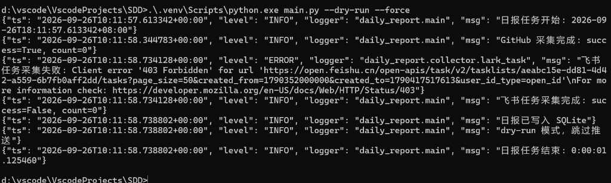

# 智能日报生成器

从 GitHub、飞书任务采集当日工作数据，按成员自动生成结构化日报（Markdown / HTML），并可通过邮件推送。

本项目按 `specs/` 规范驱动开发（SDD）落地，技术栈为 **Python 3.11+**。

---

## 功能概览

| 能力 | 说明 |
|------|------|
| 数据采集 | GitHub 提交、飞书任务状态变更 |
| 日报生成 | 按「代码提交 → 任务进展」组织，支持空记录 / 采集失败标注 |
| 推送 | SMTP 邮件（HTML） |
| 运行方式 | 命令行一次性任务（可挂 cron），非常驻服务 |
| 存储 | 本地 SQLite 保存日报历史 |

**本期不做**：AI 摘要、移动端、历史检索统计、个人编辑日报、多租户；以及飞书群消息采集与飞书群机器人推送。

---

## 目录结构

```
SDD/
├── main.py                 # 编排入口
├── collector/              # 采集层
│   ├── github.py
│   └── lark_task.py
├── generator/              # 生成层
│   ├── formatter.py
│   └── template.py
├── notifier/               # 推送层
│   └── email.py
├── shared/                 # 配置 / 日志 / 异常 / 存储 / 模型
├── tests/                  # 单元与集成测试
├── specs/                  # 需求、设计、任务与 ADR
├── docs/                   # 文档配图（如运行结果截图）
├── config.yaml.example     # 配置模板
├── .env.example            # 密钥环境变量模板
└── pyproject.toml
```

---

## 环境准备

### 1. 依赖

```powershell
cd d:\vscode\VscodeProjects\SDD
uv sync --extra dev
# 或：pip install httpx pyyaml jinja2 python-dotenv pytest
```

### 2. 配置文件

```powershell
Copy-Item config.yaml.example config.yaml
Copy-Item .env.example .env
```

编辑 `.env`（密钥，勿提交）：

| 变量 | 用途 |
|------|------|
| `GITHUB_TOKEN` | GitHub Personal Access Token |
| `LARK_APP_ID` / `LARK_APP_SECRET` | 飞书自建应用凭证（任务采集） |
| `SMTP_USERNAME` / `SMTP_PASSWORD` | 发信邮箱（可选，推送时需要） |

编辑 `config.yaml`：

- `github.repos`：仓库列表，格式 `所有者/仓库名`
- `lark.tasklist_id`：飞书任务清单 GUID（URL 里 `task-lists/` 后面那段）
- `members`：姓名与 GitHub / 飞书账号映射（可选 `lark_open_id`）
- `email.*`：SMTP 主机、收件人等

`.env`、`config.yaml` 已在 `.gitignore` 中。

---

## 如何运行

```powershell
# 健康检查
.\.venv\Scripts\python.exe main.py --check

# 采集 + 生成，不发邮件（联调推荐）
.\.venv\Scripts\python.exe main.py --dry-run --force

# 完整流程（含邮件推送）
.\.venv\Scripts\python.exe main.py --force
```

| 参数 | 含义 |
|------|------|
| `--config` | 配置文件路径，默认 `config.yaml` |
| `--check` | 只做连通性检查 |
| `--dry-run` | 不发送邮件 |
| `--force` | 忽略周末与节假日限制 |

结果写入：`data/daily_reports.db`。

### 运行结果示例

执行 `main.py --dry-run --force` 后的终端输出示例如下：



说明（对应该次联调）：

- GitHub 采集成功（当天示例仓无提交，`count=0`）
- 飞书任务因应用尚未加入任务清单返回 403，已按设计优雅降级
- 日报仍写入 SQLite；`--dry-run` 跳过邮件推送
- 整次任务正常结束

---

## 测试

```powershell
.\.venv\Scripts\python.exe -m pytest -q
```

---

## 设计要点

1. **管道架构**：采集 → 聚合 → 生成 → 推送  
2. **优雅降级**：某一数据源失败不中断整体；日报中标注「数据获取失败」  
3. **CollectResult（ADR-003）**：区分「今日无记录」与「采集失败」  
4. **身份映射**：`members` 支持邮箱、`lark_open_id` 多键对齐  
5. **安全**：密钥仅环境变量；日报不含代码 diff 正文  

规范详见 `specs/proposal.md`、`specs/design.md`、`specs/tasks.md`、`specs/adrs/`。

---

## 联调说明（简要）

| 能力 | 最低配置 |
|------|----------|
| 只验 GitHub 日报 | `GITHUB_TOKEN` + `github.repos` |
| 飞书任务 | App ID/Secret + 真实 `tasklist_id`（任务清单 GUID） |
| 邮件推送 | SMTP 主机 + 账号密码 |

---

 
